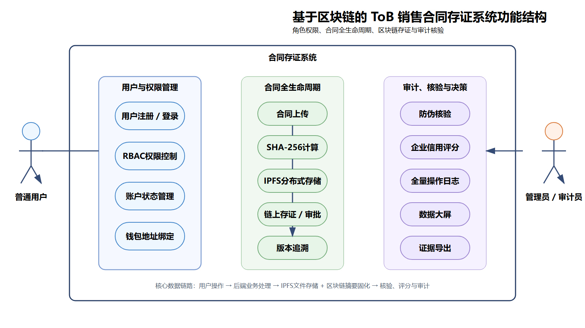
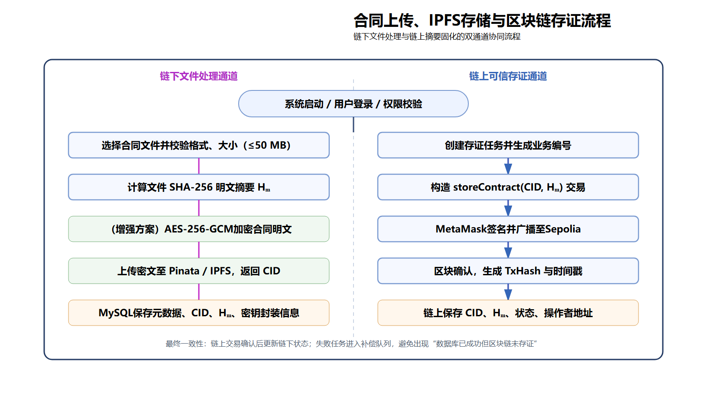

# 基于区块链的 ToB 合同存证系统

> 一个面向企业间合同签署场景的**全栈可信存证平台**：合同文件经 SHA-256 哈希后上传 IPFS，哈希与 CID 写入以太坊智能合约，实现"文件不可篡改、存证可追溯、真伪可秒级验证"。


---

## 一、项目背景

传统企业合同管理存在三个痛点：

- **中心化存储易被篡改**：合同存在单点服务器，DBA 或攻击者可直接改库；
- **真伪验证成本高**：发生纠纷时需要第三方公证，流程长、费用高；
- **跨企业协作困难**：甲乙双方各自存档，版本不一致、责任难界定。

本系统的做法：**文件本身存 IPFS 分布式网络，文件指纹（SHA-256 + CID）写入以太坊测试网智能合约**。任何人拿到一份合同文件，都可以在系统中独立校验——同时比对数据库记录与链上记录，秒级得出"可信 / 仅库内记录 / 未找到"的结论，且链上数据一经写入不可篡改。

---

## 二、系统架构

```
┌──────────────────────────────────────────────────────────┐
│                   前端 React 18 (Port 3000)              │
│   登录注册 / 合同列表 / 上传 / 详情 / 验证 / 数据看板     │
│   MetaMask 钱包唤起签名 · Ethers.js 链上交互             │
└──────────────────────────┬───────────────────────────────┘
                           │ HTTP / JWT
┌──────────────────────────┴───────────────────────────────┐
│              后端 Express (Port 5000)                     │
│   JWT 鉴权中间件 · RBAC 三角色 · Multer 文件上传          │
│   Pinata IPFS 服务 · Hardhat/Ethers 合约调用服务         │
│   Winston 分级日志 · 全链路操作审计                       │
└──────────┬───────────────────┬────────────────┬──────────┘
           │                   │                │
   ┌───────┴───────┐   ┌───────┴──────┐  ┌─────┴──────┐
   │  MySQL 8.0    │   │  IPFS 网络   │  │ Sepolia 测试网 │
   │ 业务元数据存储 │   │ Pinata 锚定  │  │ Solidity 合约 │
   └───────────────┘   └──────────────┘  └────────────┘
```



---

## 三、技术栈

| 层级 | 技术选型 |
|------|----------|
| 智能合约 | Solidity 0.8.20、Hardhat 2.19、Ethers.js v6、Sepolia 测试网 |
| 后端 | Node.js、Express、JWT、bcryptjs、Multer、Winston、Sequelize 风格 SQL |
| 前端 | React 18、React Router v6、Axios、Ethers.js v5、ECharts 数据可视化 |
| 存储 | MySQL 8.0（业务数据）、IPFS / Pinata（合同文件）、以太坊（哈希存证） |
| 工程化 | `.env` 多环境配置、数据库自动迁移、链上操作前健康检查 |

---

## 四、核心功能

### 1. 合同全生命周期管理
- **上传存证**：选择本地合同 → 前端计算 SHA-256 → 后端上传 IPFS 拿到 CID → 调用智能合约 `storeContract(cid, hash)` 上链，返回交易哈希与链上合同 ID；
- **审批流**：上传后默认待审批，管理员一键通过 / 拒绝，审批结果同步写入链上；
- **版本链**：基于已有合同派生新版本（V1 → V2 …），自动维护 `version_group_id` 与版本历史；
- **模板库**：常用合同元数据存为模板，新建时一键填充；
- **归档与到期预警**：已完结合同归档隐藏；按 `expire_at` 自动标记"7 天内到期 / 已过期"；
- **存证凭证导出**：一键生成带防伪水印与链上指纹的 HTML 凭证。

### 2. 双通道防伪校验
独立验证入口，输入合同 ID 或文件哈希：
- 同时查询 MySQL 业务记录与智能合约链上记录；
- 输出 `high / medium / none` 三级可信结论与具体命中项（链上记录是否存在、哈希是否一致、库内是否匹配）。

### 3. RBAC 三角色权限体系
| 角色 | 权限边界 |
|------|----------|
| 企业用户 User | 上传合同、管理本人合同、创建模板 |
| 管理员 Admin | 审批合同、用户管理、企业评分管理、全局数据 |
| 审计员 Auditor | 全局**只读**视图，不可写操作，保证审计独立性 |

### 4. 数据监控看板
6 类 ECharts 图表：合同状态饼图、操作类型柱状图、近 6 月存证趋势折线图、金额趋势组合图、合作方金额排行条形图、到期提醒环形图。

### 5. 企业合作评分
按企业维度聚合合同数量与总金额，自动评级（优秀 / 良好 / 合格 / 较差），支持批量管理。

---

## 五、技术亮点

> 这部分是项目的工程核心，也是面试时最常被追问的点。

1. **"文件 / 指纹"分离存储架构**：大文件走 IPFS 避免链上存储成本高昂，只把 32 字节哈希与 CID 字符串上链——既利用了区块链不可篡改的特性，又控制了 Gas 费用。
2. **双通道校验引擎**：不盲信单一数据源，同时比对 MySQL 与链上合约，输出结构化可信等级，对应"合同真伪"这一业务问题的严谨建模。
3. **链上操作前健康检查**：发起 MetaMask 签名前自动校验 ChainID 是否为 11155111、合约地址是否真的有字节码、账户是否有 Sepolia ETH 余额，提前拦截常见链上错误，避免用户白付 Gas。
4. **数据库自动迁移**：`addColumnIfMissing` + `safeExecuteDDL` 在启动时增量补字段，避免手动同步表结构，适合多环境部署。
5. **全链路操作审计**：登录、上传、审批、校验、归档等关键动作统一写入 `operation_logs`，管理员与审计员可按类型 / 时间筛选检索。
6. **Winston 分级日志**：`info / warn / error` 分文件输出（`logs/app.log`、`logs/error.log`），控制台彩色，便于线上排查。
7. **MetaMask 钱包集成**：前端通过 Ethers.js 唤起钱包签名，用户绑定钱包地址作为链上身份标识。



---

## 六、快速启动

### 环境要求
- Node.js ≥ 18
- MySQL 8.0
- MetaMask 浏览器插件（用于链上签名）

### 启动步骤

```bash
# 1. 克隆仓库
git clone https://github.com/yuzhixiang123-ui/tob-contract-evidence-system.git
cd tob-contract-evidence-system

# 2. 初始化数据库
mysql -u root -p -e "CREATE DATABASE contract_evidence CHARACTER SET utf8mb4;"
# 然后执行 init_ratings_data.sql 等根目录 SQL 脚本

# 3. 部署智能合约到 Sepolia
cd blockchain
npm install
cp .env.example .env   # 填入 SEPOLIA_RPC_URL 与 PRIVATE_KEY
npx hardhat run scripts/deploy.js --network sepolia
# 部署后把合约地址回填到 backend/.env 与 frontend/.env

# 4. 启动后端
cd ../backend
npm install
cp .env.example .env   # 填入数据库、JWT、Pinata 密钥
npm start              # http://localhost:5000

# 5. 启动前端
cd ../frontend
npm install
cp .env.example .env   # 填入后端 API 地址与合约地址
npm start              # http://localhost:3000
```

> ⚠️ 真实 `.env` 文件已在 `.gitignore` 中排除，仓库内仅提供 `.env.example` 模板；钱包私钥、数据库密码、第三方 API Key 均不会上传。

---

## 七、目录结构

```
tob-contract-evidence-system/
├── backend/                    # Express 后端
│   ├── config/                 # 数据库连接配置
│   ├── controllers/            # 业务控制器
│   ├── middleware/             # JWT 鉴权 / 角色中间件
│   ├── routes/                 # 路由：auth / contracts / admin
│   ├── services/              # Pinata IPFS 服务 / 区块链服务 / 日志服务
│   ├── uploads/               # 运行时上传目录（已 gitignore）
│   └── server.js
├── blockchain/                 # Hardhat 合约工程
│   ├── contracts/              # ContractEvidence.sol
│   ├── scripts/deploy.js       # 部署脚本
│   └── hardhat.config.js
├── frontend/                   # React 前端
│   └── src/
│       ├── pages/              # 登录 / 合同列表 / 上传 / 详情 / 验证 / 看板 / 用户管理 / 日志 / 评分
│       ├── components/
│       └── utils/              # api.js / web3.js
├── *.sql                       # 数据库初始化与增量脚本
├── 功能结构图_高清.png
├── 合同存证流程图_高清.png
└── 数据库ER图_高清.png
```

---

## 八、项目演示

- **登录页**：左右分栏品牌面板 + 三角色注册 / 登录
- **数据看板**：核心指标卡片 + 6 类业务图表
- **合同上传**：拖拽上传 → 元数据填报 → MetaMask 签名 → IPFS 与上链状态实时反馈
- **合同详情**：完整元数据 + 链上指纹（tx hash / block / 合约地址）+ 审批操作 + 版本历史 + 凭证导出
- **独立验证页**：输入 ID 或哈希，双通道比对结果可视化展示

---

## 九、许可证

MIT License

---

## 作者

**余志翔** — 区块链技术 / 全栈开发方向
- GitHub: [@yuzhixiang123-ui](https://github.com/yuzhixiang123-ui)
